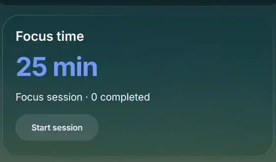
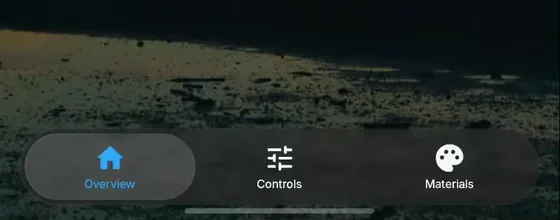

# Liquid Glass Android Kit

CodexBar Android の Liquid Glass デザインを、他の Jetpack Compose アプリでも使える形にしたキットです。

**[ブラウザで試す](https://liquid-glass-android-kit.vercel.app/ja/)** · **[テンプレートを使う](https://github.com/lingmulongtai/LiquidGlass-Android-Kit/generate)** · **[Maven ZIP を入手](https://github.com/lingmulongtai/LiquidGlass-Android-Kit/releases/latest)** · [English](README.md)

  
  
  

上の3枚は CodexBar Android v0.16.5 の Usage・Trends・Connections 画面です。Liquid Glass テーマを適用し、デモ用データで撮影されています。 [画像の出典と撮影条件](https://github.com/lingmulongtai/CodexBar-android/blob/847b3f3d3d924e0e5733b4dd9365b6a846d61863/docs/images/releases/v0.16.5/README.md)。

## 動きのデモ

| ボタンを押す | タブをドラッグして離す |
| --- | --- |
|  |  |
| [ボタンを押す · 60 fps MP4](docs/media/button.mp4) | [ドラッグして離す · 60 fps MP4](docs/media/tabs.mp4) |

Android 17 の Galaxy S25 Ultra で、同梱のスターターアプリを撮影しました。 [背景写真は Unsplash の Simon Infanger](https://unsplash.com/photos/silhouette-of-mountain-sunset-GFk79rCfJsQ) によるものです。

## 新しいアプリを作る

GitHub の **Use this template** からリポジトリを作り、Android Studio で開きます。Android SDK 36 と JDK 17 を用意し、`:app` を Android 8.0 以降の端末で実行すると、画面レイアウト、操作部品、素材の調整例を確認できます。`KitGallery.kt` を自分の画面に置き換え、`app/build.gradle.kts` のアプリ ID を変更して開発を始められます。

## 好きな部品を使う

リリースの Maven ZIP を展開し、[導入手順](README.md#add-one-component-to-an-existing-app)に沿って Gradle 依存関係を追加します。ボタンなら `GlassButton`、タブバーなら `GlassNavigationBar` を呼び出します。ほかにカード、スイッチ、スライダー、セグメント、入力欄、ヘッダーを使えます。ソースを直接編集したい場合は `:designkit` をモジュールとして取り込めます。

`GlassTheme` は元アプリの配色、形状、Inter、ガラス素材の初期値を提供します。`GlassBackdropLayout` に背景を渡すと、その背景を部品が描画に使います。Android 13 以降は屈折、Android 12 はぼかし、Android 8〜11 は色による表示に切り替わります。

[詳しい導入例](docs/integration.md) · [MIT ライセンス](LICENSE) · [著作権と同梱ライセンス](NOTICE.md)
