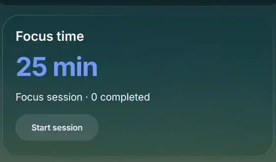
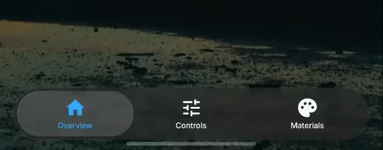

# Liquid Glass Android Kit

Native Jetpack Compose components and a starter app based on the Liquid Glass
design from CodexBar for Android. Use the starter to build a new app, or add the
library and use only the components your app needs.

**[Live playground](https://liquid-glass-android-kit.vercel.app/)** · **[Use this template](https://github.com/lingmulongtai/LiquidGlass-Android-Kit/generate)** · **[Download the Maven ZIP](https://github.com/lingmulongtai/LiquidGlass-Android-Kit/releases/latest)** · [日本語](README.ja.md)

<p align="center">
  <a href="https://github.com/lingmulongtai/CodexBar-android/blob/847b3f3d3d924e0e5733b4dd9365b6a846d61863/docs/images/releases/v0.16.5/usage-tabs.png"></a>
  <a href="https://github.com/lingmulongtai/CodexBar-android/blob/847b3f3d3d924e0e5733b4dd9365b6a846d61863/docs/images/releases/v0.16.5/trends-tabs.png"></a>
  <a href="https://github.com/lingmulongtai/CodexBar-android/blob/847b3f3d3d924e0e5733b4dd9365b6a846d61863/docs/images/releases/v0.16.5/connections-tabs.png"></a>
</p>

The three screenshots show the Usage, Trends and Connections tabs in CodexBar for Android v0.16.5 with the Liquid Glass theme and demo data. [Source screenshots and capture notes](https://github.com/lingmulongtai/CodexBar-android/blob/847b3f3d3d924e0e5733b4dd9365b6a846d61863/docs/images/releases/v0.16.5/README.md).

## See it in motion

| Button press | Tab drag and release |
| --- | --- |
| [](docs/media/button.mp4) | [](docs/media/tabs.mp4) |
| [Button press · 60 fps MP4](docs/media/button.mp4) | [Drag and release · 60 fps MP4](docs/media/tabs.mp4) |

Captured from the starter app on a Galaxy S25 Ultra running Android 17. [Backdrop photo by Simon Infanger on Unsplash](https://unsplash.com/photos/silhouette-of-mountain-sunset-GFk79rCfJsQ).

## Start an app

1. On GitHub, select **Use this template**, then clone your new repository.
2. Open it in Android Studio with **Android SDK 36** and **JDK 17**.
3. Run the `:app` configuration on an Android 8.0+ device. The gallery includes
   a screen layout, controls and a live material editor.
4. Change the application ID in `app/build.gradle.kts` and replace
   `KitGallery.kt` with your own screens. Keep `:designkit` as a local module.

From the command line, run `./gradlew :app:assembleDebug` on macOS/Linux or
`.\gradlew.bat :app:assembleDebug` on Windows.

## Add one component to an existing app

Download `liquidglass-compose-0.1.0-maven.zip` from
[Releases](https://github.com/lingmulongtai/LiquidGlass-Android-Kit/releases).
Unzip it into `third_party/liquidglass` in your project. Add this repository to
your existing `dependencyResolutionManagement.repositories` in
`settings.gradle.kts` alongside `google()` and `mavenCentral()`.

```kotlin
maven {
    url = uri("third_party/liquidglass/maven")
    content { includeGroup("io.github.lingmulongtai") }
}
```

In the Compose app module add:

```kotlin
implementation("io.github.lingmulongtai:liquidglass-compose:0.1.0")
```

Now you can use only the button, for example:

```kotlin
import androidx.compose.material3.Text
import androidx.compose.runtime.Composable
import io.github.lingmulongtai.liquidglass.GlassButton
import io.github.lingmulongtai.liquidglass.GlassTheme

@Composable
fun SaveAction(onSave: () -> Unit) {
    GlassTheme {
        GlassButton(onClick = onSave) {
            Text("Save")
        }
    }
}
```

`GlassBackdropLayout` adds live sampling behind your components and accepts a
custom gradient or background composable. Components can also be used on an
existing screen without a backdrop; their tint fallback remains available.
Android 13+ uses refraction on supported hardware, Android 12 uses blur, and
Android 8–11 use the tint fallback.

| Part | API |
| --- | --- |
| Color, typography, shapes and materials | `GlassTheme`, `glassColorScheme`, `GlassStyle`, `GlassTuning` |
| Background and custom glass | `GlassBackdropLayout`, `GlassSurface`, `rememberGlassBackdrop`, `glassBackdropSource` |
| Buttons and chips | `GlassButton`, `GlassOutlinedButton`, `GlassTextButton`, `GlassIconButton`, `GlassFilterChip` |
| Inputs | `GlassSwitch`, `GlassSlider`, `GlassSegmentedControl`, `GlassTextField` |
| Layout and navigation | `GlassCard`, `GlassTopBar`, `GlassNavigationBar`, `GlassTab` |

See [integration recipes](docs/integration.md) for a custom background, a
standalone card, a tab bar and the source-module route. The library is
[MIT-licensed](LICENSE). Font and upstream notices are in [NOTICE](NOTICE.md).
